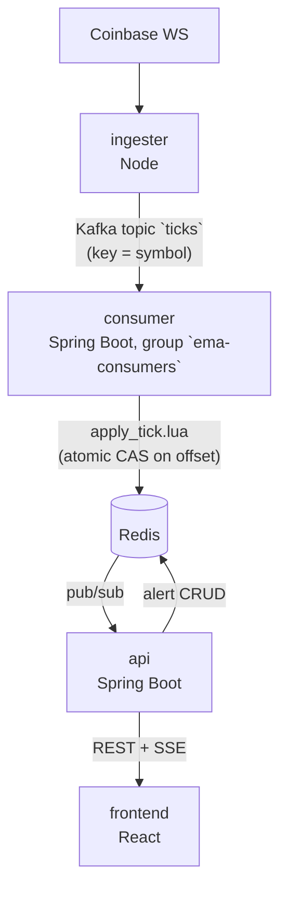

# Real-Time Market Data & Alerting Pipeline

A live crypto market dashboard: trades stream from Coinbase's public WebSocket through Kafka into a Spring Boot consumer that computes a time-decayed EMA and evaluates user-defined price alerts, with results pushed to a React frontend over Server-Sent Events. Built to understand — and be able to explain in depth — the distributed-systems problems that show up the moment a system has to survive restarts, rebalances, and replays: exactly-once-ish state updates without Kafka transactions, consumer group rebalancing, and reproducible floating-point computation across processes.

**Live demo:** https://market-data-pipeline-one.vercel.app
**API:** https://api.ayomideo.dev/api/symbols

## Architecture



Single Kafka broker (KRaft, no ZooKeeper), one partition per symbol for strict ordering. The API never touches Kafka and never holds authoritative state — Redis is the single source of truth for everything it serves.

## Tech stack

| Component | Stack |
|---|---|
| Ingester | Node.js, Confluent's Kafka client |
| Consumer | Java, Spring Boot, Spring for Apache Kafka |
| API | Java, Spring Boot (REST + SSE) |
| Frontend | React, Vite, TypeScript |
| Infra | Kafka (KRaft), Redis (AOF), Docker Compose, Caddy (TLS), Oracle Ampere (arm64) |
| Observability | Sentry (all four components) |

## Engineering problems actually solved

This project is less about streaming trades and more about what breaks when a consumer can crash mid-write, get rebalanced, or replay history — and what it takes to make that safe.

- **The offset-commit question, and why an EMA isn't idempotent.** A time-decayed EMA can't just be recomputed from a replayed tick — applying the same tick twice shifts the average incorrectly, unlike a pure function of price alone. The consumer commits a Kafka offset only *after* Redis confirms the write, and a replayed tick is detected and skipped rather than reapplied. → [`apply_tick.lua`'s return shape, and the bug this caught before it shipped](DECISIONS.md#ema-not-idempotent)
- **The atomic compare-and-set in Lua.** EMA math stays in a plain, unit-tested Java class with no Redis imports; the Lua script's only job is an atomic, single-round-trip conditional write (apply if offset is newer, skip otherwise). Splitting it this way keeps the atomic part small enough to audit at a glance. → [Why EMA math is in Java, atomicity is in Lua](DECISIONS.md#atomic-cas-lua)
- **Cooperative-sticky rebalancing, with cache clearing on revocation.** Running multiple consumer instances means partitions move between them. The in-memory EMA cache is cleared for exactly the symbols revoked — not a full flush — so a rebalance costs the least state it has to. → [Assignor choice and revocation handling](DECISIONS.md#cooperative-sticky-rebalancing)
- **An independent verification tool that caught a real reproducibility bug.** `tools/verify-ema` recomputes the EMA from scratch, independently, and compares it to Redis. It disagreed with the live consumer in the 8th decimal place — not a rounding fluke, but `Math.exp`'s JVM-specific, non-reproducible approximation. Fixed by switching to `StrictMath.exp`. → [The incident, caught by disagreement, not by reading the javadoc first](DECISIONS.md#verify-ema-math-exp-bug)

Every non-obvious decision in this project — including ones that turned out wrong and were corrected — is recorded in [DECISIONS.md](DECISIONS.md) as it was made, not after.

## Local setup

Requires Docker, Node.js, Java 21+, and Maven.

```bash
# Kafka + Redis
docker compose up -d

# Ingester
cd ingester && npm install && cp .env.example .env && npm run dev

# Consumer (separate terminal)
cd consumer && mvn spring-boot:run

# API (separate terminal)
cd api && mvn spring-boot:run

# Frontend (separate terminal)
cd frontend && npm install && cp .env.example .env && npm run dev
```

Each stage of the build has its own `scripts/verify-stageN.sh` with both automated checks and a manual verification checklist.
